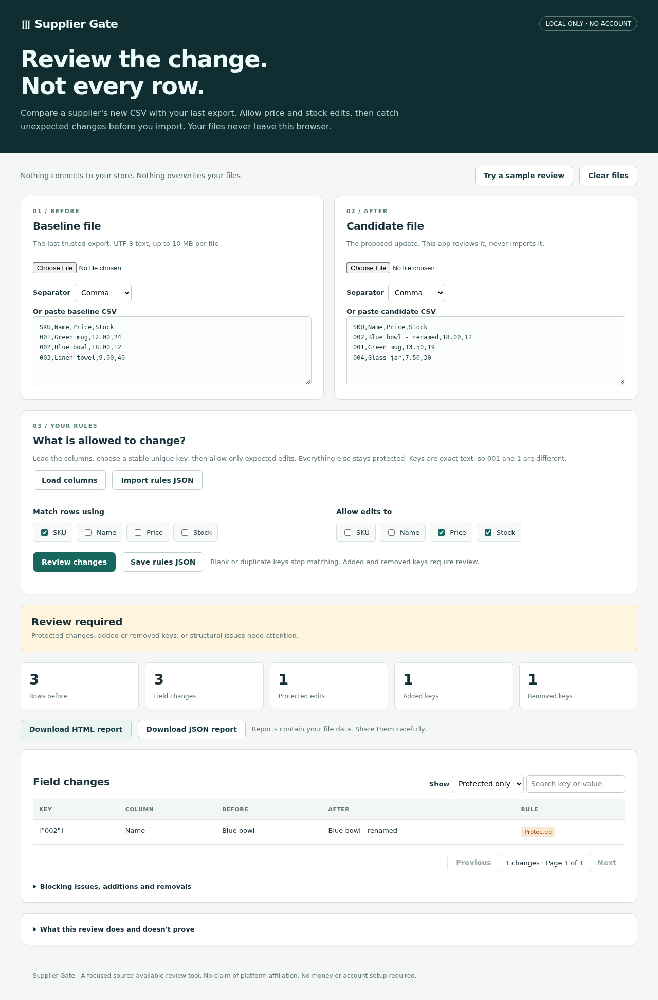

# Supplier Gate

**Review expected supplier CSV edits without overlooking protected product data.**

A complete, bounded offline review workflow: compare a trusted export with a proposed update, choose stable key columns, allow expected edits such as price or stock, and inspect everything else. No account, server, AI, store connection, analytics or runtime dependencies.

**Status:** engineering preview. The defined comparison workflow is implemented and tested, but usefulness to real catalog teams and willingness to pay have not been established. This is not a store-specific validator and does not certify an import as safe.



## Latest fix

v0.1.1 prevents a slow file read from overwriting newer pasted/demo input, and invalidates interim results when a current file read completes. Covered by two deterministic browser regressions.

## Run it

1. Download the release ZIP and extract it.
2. Double-click `SupplierGate.html`.
3. Click **Try a sample review**, or load your own baseline and candidate CSVs.
4. Load columns, select a unique key (or composite key), and allow only fields you expect to change.
5. Review changes and download an HTML or JSON report. Rules can be saved and reused as JSON.

The single HTML file works from disk without installation or an internet connection. Developer tools are not required by users.

## Review semantics

- Values remain text. `001`, `1`, `1.0` and `1.00` are different.
- Rows match by selected keys, independent of row order. Columns match by exact header, independent of column order.
- All non-key fields are protected unless explicitly allowed.
- Added/removed keys and added/removed columns always require review.
- Empty or duplicate keys stop matching instead of picking an arbitrary record.
- Broken quotes, ragged rows, empty/duplicate headers, NUL bytes and encoding problems are rejected. Nothing is guessed or auto-repaired.
- A changed key appears as a removal and an addition. Whitespace and letter case are not normalized.
- Comma, semicolon, tab and pipe separators are supported and explicitly selected per file.
- UTF-8 only, with or without BOM. Limits: 10 MB and 50,000 data rows per input.
- Reports include selected rules, counts, changes, source line numbers, key additions/removals and a SHA-256 digest of decoded text when available. The digest describes decoded UTF-8 text, not the original file bytes.

A result of **Within your selected rules** means exactly that. It says nothing about valid prices, taxes, required platform fields, image URLs, inventory correctness or your authorization to import. Keep backups and test a small slice in a staging environment or importer preview.

## Privacy and safety

Processing stays in browser memory. No network requests, persistence, telemetry, payments or credentials. The content-security policy blocks connections. Reload or close to clear the session. Downloaded reports contain your file data, so handle them like the original files. Untrusted cell values are displayed as text, and HTML reports escape them. No CSV results are exported, avoiding accidental spreadsheet formula execution in a generated CSV report.

## Why this exists, and what is not proved

The specific workflow is **allow expected edits, escalate everything else**, rather than a general-purpose spreadsheet editor. It is a simpler alternative to assembling a repeatable keyed comparison and protection policy by hand.

Research notes and competing tools are in [docs/evidence.md](docs/evidence.md). The available community examples are from October 2026 and older, not proof of current purchase intent. Existing free CSV tools overlap substantially. The next validation question is whether teams find an explicit protected-field review policy and portable offline report useful enough to adopt. No customers, revenue, endorsements or superiority claims are implied.

## Develop and test

Node.js 20 or newer:

```sh
npm ci
npm run build
npm test
npx playwright install chromium
npm run test:browser
```

`core.js` contains the strict parser, matching policy and HTML report renderer. `app.js` contains the browser workflow. `template.html` supplies the responsive interface. `node build.js` bundles these into a single self-contained file in `dist/`.

Tests cover quoted/newline fields, all supported delimiters, leading zeros, large numeric-looking strings, malformed CSV, duplicate/empty keys, schema changes, composite-key collisions, HTML injection, 50,000-row comparison and 200 deterministic generated parser cases. Browser tests include deterministic slow-file-read race regressions and cover sample and real-input workflows, file decoding, filters, downloads, rules import/export, reset, desktop/mobile layout and no-network operation.

Tested automatically in Chromium on Linux. Windows/macOS browsers, Firefox, WebKit and assistive technology have not yet been verified. Do not infer support from a screenshot or the file format alone.

## Source terms

Source is visible for inspection. No open-source license or commercial license is granted in this preview. Third-party development dependencies retain their own licenses. Runtime has no third-party library. See `NOTICE.md`.
